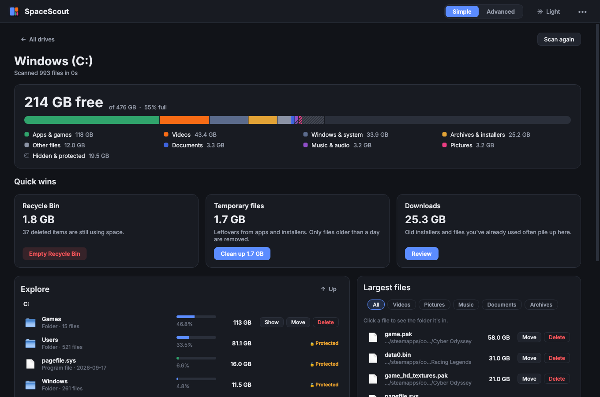
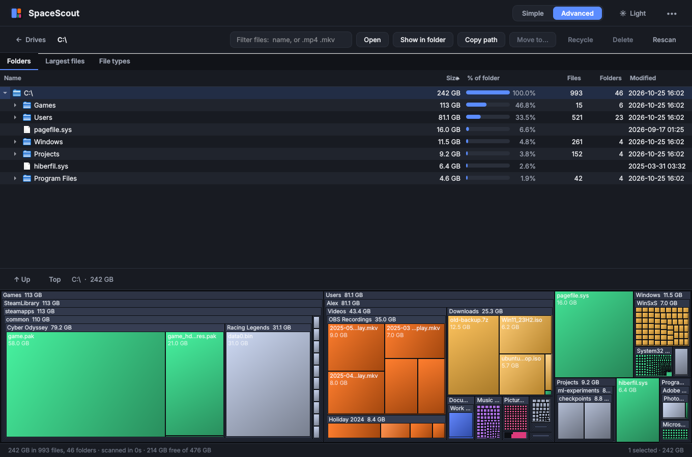
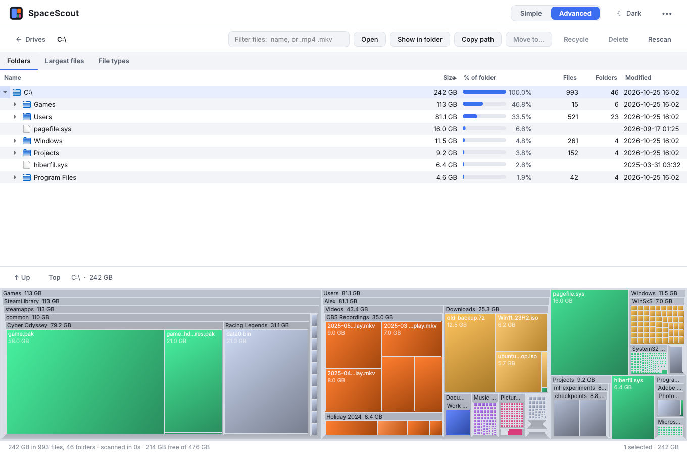

<p align="center">
  
</p>

<h1 align="center">SpaceScout</h1>

<p align="center">
  See what's filling your drives, then delete it or move it to another drive.<br>
  A free, open-source disk space analyzer in the spirit of WizTree and WinDirStat, with a <b>Simple mode</b> for everyone and an <b>Advanced mode</b> for power users.
</p>

<p align="center">
  <a href="../../actions/workflows/build.yml"></a>
  <a href="../../releases/latest"></a>
  
</p>



## Features

### Simple mode: for anyone
- **One-glance overview**: free space, plus a colour bar showing what's using it (Videos, Pictures, Apps & games, Windows, and so on).
- **Quick wins**: empty the Recycle Bin, clean old temporary files, review your Downloads folder.
- **Explore**: click into folders and see the biggest things first. Each item has **Show**, **Move** and **Delete** buttons.
- **Largest files**, filterable by type.
- **Safe by default**: Delete goes to the Recycle Bin. Windows folders, installed programs, and other things your PC needs are locked 🔒 and can't be touched.

### Advanced mode: for power users

- **Folder tree** with size, % of parent, file and folder counts, and last-modified date. Sort by any column.
- **Treemap** (like WizTree and WinDirStat), coloured by file type. Click to select, double-click to zoom in, right-click for actions.
- **Largest files** list (top 1,000) with filters: type `.mp4 .mkv`, or part of a name or path.
- **File types** breakdown. Double-click a type to list its biggest files.
- **Multi-select**, **Del** = Recycle Bin, **Shift+Del** = permanent delete, **Ctrl+C** = copy path, **F5** = rescan.
- Installed programs and AppData *can* be changed here, after an extra warning. Core Windows files are still always blocked.

### Move to another drive
Running out of space on C:? Select files or folders, click **Move**, pick a drive:
- The drive list shows how much free space each drive has, and won't let you pick one that's too small.
- **Copy → verify → delete**: everything is copied and size-checked *before* the original is removed. If the move fails or you stop it, your originals stay put.
- **Keep the original folder layout** (on by default): `C:\Users\You\Videos` lands in `D:\Moved from C\Users\You\Videos`, so things are easy to find.
- **Leave a link behind** (Advanced mode, folders only): creates a Windows junction at the old location, so games and apps keep working after you move their folders.

### Also
- Dark and light themes.
- Scan a whole drive or any folder.
- "Hidden & protected" shows space the scan couldn't read. Run as administrator to see more.
- OneDrive cloud-only files count as 0 bytes, because they aren't actually on your disk.



## Download

Go to **[Releases](../../releases/latest)** and download `SpaceScout.exe`. There's no installer: just run it.

> **"Windows protected your PC"?** That's SmartScreen. It warns about any new app that isn't code-signed (signing certificates cost money). Click **More info → Run anyway**. The exe is built in the open by GitHub Actions from the code in this repo.

## Run from source

Requires Python 3.10 or newer from [python.org](https://www.python.org/downloads/).

```bash
pip install -r requirements.txt
python run.py                 # opens the app
python run.py C:\             # opens and scans C: straight away
python run.py --advanced D:\  # start in Advanced mode
```

## Build the .exe yourself (Windows)

Double-click **`build.bat`**, or run:

```bash
pip install -r requirements.txt pyinstaller
pyinstaller SpaceScout.spec --noconfirm --clean
```

Your app will be at `dist\SpaceScout.exe`.

## Put it on GitHub (step by step)

1. Create a new **empty** repository on GitHub, for example `spacescout`. Don't add a README or license, because this project already has them.
2. In this folder, run:
   ```bash
   git init
   git add .
   git commit -m "SpaceScout 1.0"
   git branch -M main
   git remote add origin https://github.com/YOUR-USERNAME/spacescout.git
   git push -u origin main
   ```
3. GitHub Actions automatically runs the tests and builds `SpaceScout.exe`. You'll find it under the **Actions** tab → latest run → **Artifacts**.
4. **To publish a release** with the exe attached, tag a version:
   ```bash
   git tag v1.0.0
   git push origin v1.0.0
   ```
   A few minutes later, it shows up under **Releases** with `SpaceScout.exe` ready to download.

When you release a new version, bump `__version__` in `src/spacescout/__init__.py` and push a new tag (for example `v1.1.0`).

## How it works

| File | What it does |
|---|---|
| `src/spacescout/scanner.py` | Walks the drive with `os.scandir` (Windows returns sizes with the directory listing, so no extra calls per file) and builds an in-memory tree sorted largest-first. |
| `src/spacescout/fileops.py` | Recycle Bin (Windows Shell API), permanent delete, copy-verify-delete moves, temp cleanup, junctions. |
| `src/spacescout/safety.py` | The rules for what's protected (always blocked vs. Advanced-only). |
| `src/spacescout/categories.py` | Maps file extensions and well-known folders to friendly categories. |
| `src/spacescout/ui/` | The PySide6 (Qt) interface: `simple_view.py`, `advanced_view.py`, `treemap.py` (squarified treemap), and dialogs. |
| `tests/` | Unit and UI tests (`pytest`). They run headless in CI on Windows and Linux. |

### Develop

```bash
pip install -r requirements-dev.txt
pytest                      # run the tests
ruff check src tests        # lint
python scripts/make_demo_tree.py demo   # fake 240 GB demo folder (sparse files, uses ~no disk)
python run.py demo
```

## Good to know

- **Speed**: WizTree reads the NTFS master file table directly, which needs admin rights and is extremely fast. SpaceScout uses normal file APIs instead. It's slower on huge drives (expect roughly 30 seconds to a couple of minutes for a full C:), but it works without admin rights and on any drive type, including USB sticks, network drives and exFAT.
- **Administrator**: some system folders can only be read as admin. Use **••• → Restart as administrator** to see them.
- **Sizes** are file sizes, as Explorer's "Size" column shows them. Hard-linked Windows system files may be counted more than once, so the *Windows & system* total can look slightly bigger than reality.
- Works on macOS and Linux too (Trash instead of Recycle Bin). The Windows build is the main target.

## License

[MIT](LICENSE). Free to use, change and share.
